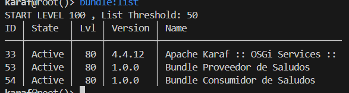
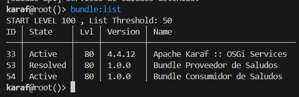
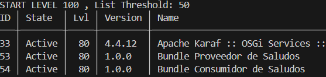
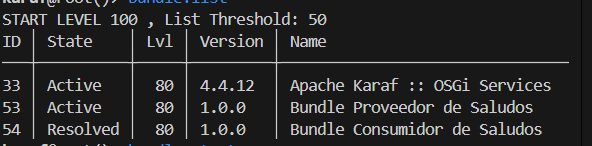

# Pruebas del sistema OSGi

**Autor:** Samuel Cobo

## 1. Ejecución en Apache Karaf

Se utilizó Apache Karaf 4.4.12 para ejecutar los dos bundles desarrollados en Java.

El Bundle A publica el servicio de saludos y el Bundle B lo consume mediante la interfaz SaludoService.

## 2. Comunicación entre bundles

Se instalaron ambos bundles y se comprobó que podían comunicarse.

El Bundle B mostró el mensaje:

"Hola, Samuel! Bienvenido al sistema OSGi."

## 3. Parada del proveedor

Se ejecutó `bundle:stop 53`.

El Bundle A pasó al estado Resolved, mientras que el Bundle B permaneció Active.

El consumidor detectó que el servicio dejó de estar disponible, pero no se detuvo.

## 4. Reinicio del proveedor

Se ejecutó `bundle:start 53`.

El consumidor detectó nuevamente el servicio y mostró el saludo sin necesidad de reiniciarse.

## 5. Parada del consumidor

Se ejecutó `bundle:stop 54`.

El proveedor permaneció Active mientras el consumidor pasó a Resolved.

Después se inició nuevamente el consumidor con `bundle:start 54`.

## 6. Conclusión

Las pruebas permitieron comprobar el funcionamiento independiente de los bundles en Apache Karaf.

La comunicación se realiza mediante el registro de servicios OSGi y una interfaz compartida, evitando que el consumidor dependa directamente de la implementación del proveedor.

Esto permite detener y reiniciar módulos durante la ejecución sin apagar todo el sistema.

También se comprobó que, cuando el proveedor se detiene, el consumidor sigue activo, aunque la funcionalidad de saludos queda temporalmente no disponible.
