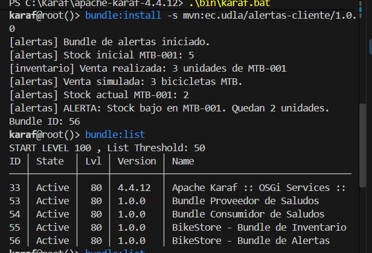
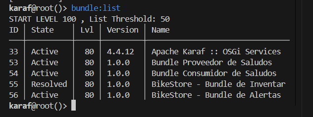
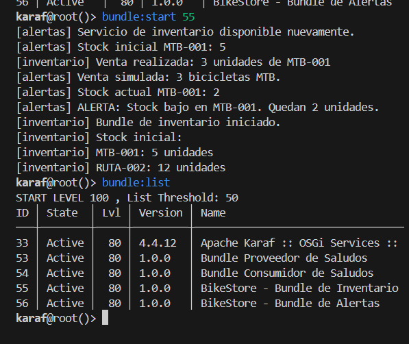
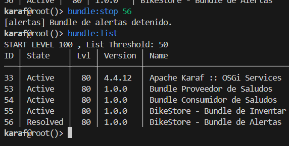
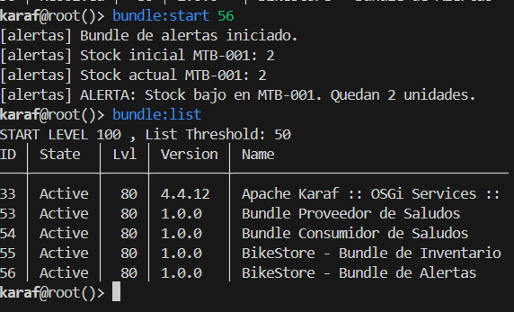
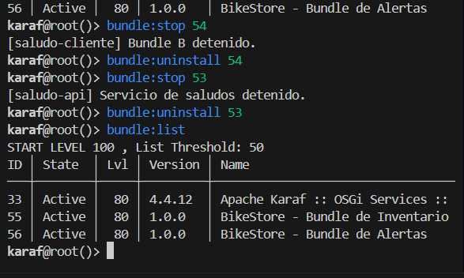

# Evidencias de ejecución — BikeStore con OSGi

**Autor:** Samuel Cobo  
**Plataforma:** Apache Karaf 4.4.12  
**Rama:** [`mejora/bikestore-osgi`](https://github.com/CoboSamuel/OSGI/tree/mejora/bikestore-osgi)

## 1. Qué se puso a prueba

Se implementaron dos bundles OSGi: `inventario-api` (proveedor del contrato `InventarioService`) y `alertas-cliente` (consumidor y oyente de cambios de disponibilidad). Las comprobaciones se realizaron **manualmente dentro de la consola de Apache Karaf**, después de compilar con `.\mvnw.cmd clean install` en Windows.

En la sesión documentada, los IDs fueron **55** para Inventario y **56** para Alertas. Son IDs de esa instalación; en otra ejecución pueden cambiar.

## 2. Prueba 1: comunicación, venta simulada y stock bajo

**Comandos en Karaf:**

```text
bundle:install -s mvn:ec.udla/inventario-api/1.0.0
bundle:install -s mvn:ec.udla/alertas-cliente/1.0.0
bundle:list
```

**Salida observada:**

```text
[alertas] Bundle de alertas iniciado.
[alertas] Stock inicial MTB-001: 5
[inventario] Venta realizada: 3 unidades de MTB-001
[alertas] Venta simulada: 3 bicicletas MTB.
[alertas] Stock actual MTB-001: 2
[alertas] ALERTA: Stock bajo en MTB-001. Quedan 2 unidades.
```

**Comprobación:** los dos bundles estaban `Active`. La venta descontó tres unidades de las cinco iniciales y la regla de stock bajo se activó al quedar dos, cifra inferior o igual al umbral de tres unidades. La operación demuestra una llamada real del consumidor a la interfaz OSGi del proveedor.



## 3. Prueba 2: detener el proveedor sin detener el consumidor

**Comandos en Karaf:**

```text
bundle:stop 55
bundle:list
```

**Salida observada:**

```text
[alertas] Inventario no disponible temporalmente.
[alertas] El bundle de alertas sigue activo.
[inventario] Servicio de inventario detenido.
```

| ID | Bundle | Estado |
|---:|---|---|
| 55 | Inventario | `Resolved` |
| 56 | Alertas | `Active` |

**Comprobación:** el bundle de Alertas siguió activo cuando Inventario dejó de publicar el servicio. No puede consultar stock durante esa ausencia, pero recibe el cambio de disponibilidad y no requiere reinicio.



## 4. Prueba 3: reiniciar el proveedor y recuperar el servicio

**Comandos en Karaf:**

```text
bundle:start 55
bundle:list
```

**Salida observada:**

```text
[alertas] Servicio de inventario disponible nuevamente.
[alertas] Stock inicial MTB-001: 5
[inventario] Venta realizada: 3 unidades de MTB-001
[alertas] Venta simulada: 3 bicicletas MTB.
[alertas] Stock actual MTB-001: 2
[alertas] ALERTA: Stock bajo en MTB-001. Quedan 2 unidades.
```

**Comprobación:** Alertas detectó el retorno del servicio sin detenerse ni reiniciarse. La existencia inicial volvió a cinco porque el inventario es una estructura en memoria que se crea de nuevo al iniciar el proveedor.



## 5. Prueba 4: detener solo Alertas

**Comandos en Karaf:**

```text
bundle:stop 56
bundle:list
```

| ID | Bundle | Estado esperado en la prueba |
|---:|---|---|
| 55 | Inventario | `Active` |
| 56 | Alertas | `Resolved` |

**Comprobación:** Inventario puede mantenerse activo aunque se detenga el consumidor. Esto evidencia la independencia de sus ciclos de vida.



## 6. Prueba 5: reiniciar Alertas

**Comandos en Karaf:**

```text
bundle:start 56
bundle:list
```

**Comprobación:** Alertas volvió a `Active`, encontró el servicio ya publicado por Inventario y consultó nuevamente el stock. Ambos quedaron activos.



## 7. Verificación de la arquitectura final

Se retiraron de la rama de BikeStore los módulos antiguos `saludo-api` y `saludo-cliente`, conservando esa versión histórica en `main`. También se desinstalaron de Karaf los bundles de saludos; el objetivo es que la demostración final muestre únicamente los dos módulos propios de BikeStore, además de los servicios internos del contenedor.

**Los comandos para la limpieza**, una vez verificados los IDs con `bundle:list`, fueron:

```text
bundle:stop 54
bundle:uninstall 54
bundle:stop 53
bundle:uninstall 53
bundle:list
```

No deben ejecutarse esos IDs sin comprobar antes que siguen correspondiendo a los módulos de saludos.



## 8. Alcance de las conclusiones

Los resultados corresponden a pruebas manuales de integración, no a pruebas unitarias automatizadas. Se demuestra **modularidad, bajo acoplamiento respecto de la implementación, disponibilidad parcial y recuperación dinámica**. No se afirma persistencia de datos, ventas reales, notificaciones externas ni supervisión continua del stock: esas capacidades no fueron implementadas.

La prueba más significativa fue observar a **Inventario `Resolved` y Alertas `Active`**, seguida del retorno automático del servicio cuando Inventario volvió a iniciarse. Esta es la evidencia directa de la administración independiente de bundles que buscaba la actividad.
