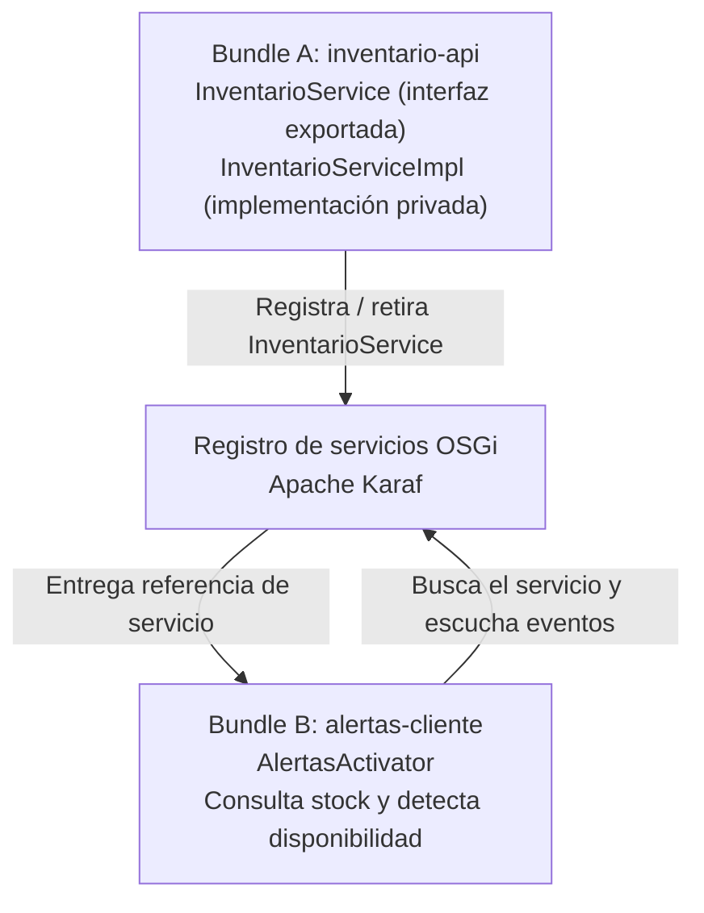
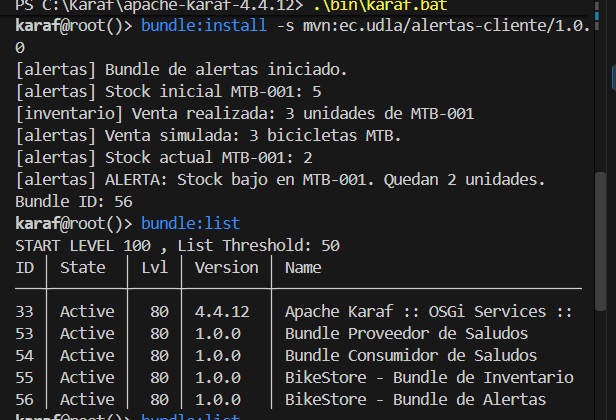
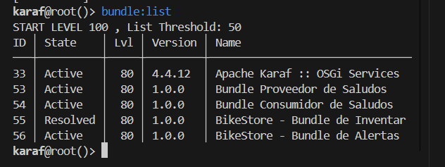
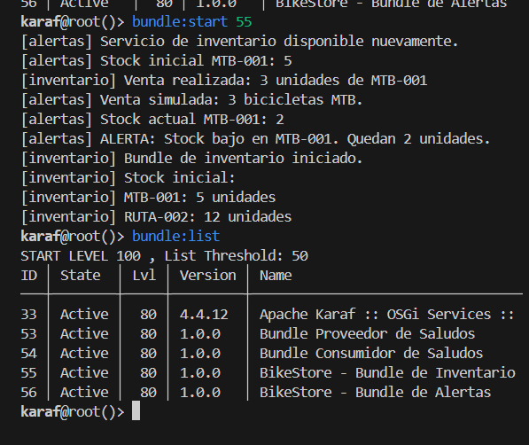
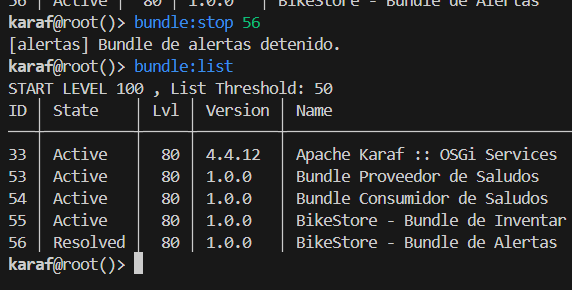
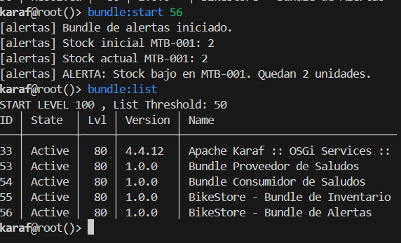

# BikeStore — Inventario y alertas con OSGi y Apache Karaf

**Autor:** Samuel Cobo  
**Carrera:** Ingeniería de Software  
**Asignatura:** Diseño y Arquitectura de Software  
**Repositorio:** https://github.com/CoboSamuel/OSGI  
**Versión de BikeStore:** rama [`mejora/bikestore-osgi`](https://github.com/CoboSamuel/OSGI/tree/mejora/bikestore-osgi)

## 1. ¿Qué problema queríamos resolver?

En una tienda de bicicletas, el control de existencias y las alertas de stock son responsabilidades relacionadas, pero no tienen por qué formar un único componente indivisible. Si el inventario se detiene para mantenimiento, sería útil que el módulo de alertas no se cierre junto con él y pueda reconocer cuándo vuelve a estar disponible.

Para demostrar esta situación desarrollamos **BikeStore**, una aplicación pequeña con **dos bundles OSGi** que se comunican mediante el **registro de servicios de Apache Karaf**:

- **Inventario:** almacena cantidades de bicicletas en memoria, permite consultar existencias y registrar una venta simulada.
- **Alertas:** consume el contrato de inventario, comprueba el stock de una bicicleta y muestra una alerta si quedan pocas unidades. También detecta la aparición y desaparición del servicio.

El objetivo principal **no es construir una tienda comercial completa**, sino demostrar modularidad, comunicación mediante interfaces, administración independiente del ciclo de vida y recuperación de servicios durante la ejecución.

## 2. Herramientas utilizadas

| Herramienta | Uso |
|---|---|
| Java 21.0.12 | JDK utilizado durante el desarrollo y la ejecución |
| Compatibilidad Java 17 | Configuración `maven.compiler.release=17` para compilar los JAR |
| Maven Wrapper | Compilación y empaquetado sin exigir Maven instalado globalmente |
| OSGi Core 8.0.0 | API para bundles, activadores, servicios y eventos |
| Apache Felix Maven Bundle Plugin 5.1.9 | Construcción de JAR con metadatos OSGi |
| Apache Karaf 4.4.12 | Contenedor para instalar, iniciar, detener y desinstalar bundles |
| VS Code, PowerShell, Git y GitHub | Desarrollo, ejecución, versionamiento y evidencias |

**Diferencia importante:** OSGi establece el modelo modular y el ciclo de vida; **Karaf es el entorno donde ejecutamos ese modelo**. Maven prepara los artefactos, pero `BUILD SUCCESS` por sí solo no prueba su comportamiento dentro de Karaf.

## 3. Arquitectura del sistema



### Bundle A: `inventario-api`

Sus componentes principales son:

- **`InventarioService.java`:** contrato público que define `consultarStock(String codigo)` y `registrarVenta(String codigo, int cantidad)`.
- **`InventarioServiceImpl.java`:** implementación interna que administra un `Map<String, Integer>` con las existencias. Los métodos son `synchronized` para proteger las operaciones del mapa frente a accesos simultáneos a esta instancia.
- **`InventarioActivator.java`:** implementa `BundleActivator`; al comenzar registra una instancia del servicio con `context.registerService(...)` y al detenerse la desregistra.

Inventario inicial de la demostración:

| Código | Tipo | Unidades iniciales |
|---|---|---:|
| `MTB-001` | Bicicleta de montaña | 5 |
| `RUTA-002` | Bicicleta de ruta | 12 |

La implementación rechaza ventas con cantidad no positiva, productos inexistentes o existencias insuficientes. `consultarStock` devuelve `-1` si el código no existe. **Los datos están en memoria y se reinician al volver a crear el servicio; no hay base de datos ni persistencia.**

### Bundle B: `alertas-cliente`

El componente principal es **`AlertasActivator.java`**, que implementa `BundleActivator` y `ServiceListener`.

Cuando inicia, registra un oyente para `InventarioService` y busca una referencia al servicio. Si lo encuentra, consulta la MTB-001; si tiene al menos cinco unidades, ejecuta una **venta simulada de tres bicicletas** y consulta el nuevo stock. Si quedan **tres unidades o menos**, imprime una alerta.

Cuando el servicio se retira del registro OSGi, muestra que el inventario no está disponible, pero **el bundle de alertas sigue activo**. Cuando el servicio vuelve a registrarse, lo detecta y repite la comprobación.

### ¿Por qué se considera bajo acoplamiento?

El consumidor conoce **la interfaz `InventarioService`**, pero no construye ni referencia directamente `InventarioServiceImpl`. Por eso puede solicitar el servicio al registro OSGi, usarlo cuando existe y reaccionar si desaparece. **No implica ausencia total de dependencias**: ambos módulos comparten deliberadamente el contrato Java y el consumidor necesita ese paquete exportado para resolver sus clases.

En el archivo Maven del proveedor se exporta `ec.udla.inventario.api` y se mantiene privada la implementación `ec.udla.inventario.impl`. En el consumidor la dependencia a `inventario-api` tiene alcance `provided`, ya que el contrato se resuelve en el entorno OSGi.

## 4. Estructura del repositorio

```text
OSGI/
├── .mvn/                           # Configuración de Maven Wrapper
├── inventario-api/
│   ├── pom.xml
│   └── src/main/java/ec/udla/inventario/
│       ├── api/InventarioService.java
│       └── impl/
│           ├── InventarioServiceImpl.java
│           └── InventarioActivator.java
├── alertas-cliente/
│   ├── pom.xml
│   └── src/main/java/ec/udla/alertas/cliente/
│       └── AlertasActivator.java
├── evidencias/                     # Capturas de las pruebas
├── EVIDENCIAS.md                   # Explicación de cada comprobación
├── README.md
├── mvnw
├── mvnw.cmd
└── pom.xml                       # Maven multi-módulo
```

El `pom.xml` principal enumera solamente `inventario-api` y `alertas-cliente`. En la rama `main` se conservó la **primera versión didáctica de saludos**; BikeStore se desarrolló y documentó en `mejora/bikestore-osgi`, para mantener separado el historial.

## 5. Cómo desarrollamos y comprobamos BikeStore

1. Partimos de un proyecto OSGi con Maven Wrapper y una primera demostración de servicios entre bundles.
2. Creamos la rama `mejora/bikestore-osgi` para conservar el prototipo anterior.
3. Desarrollamos `inventario-api`, lo compilamos y verificamos en Karaf que podía registrarse como servicio.
4. Desarrollamos `alertas-cliente`, configurando su dependencia con la interfaz del inventario y la escucha de eventos OSGi.
5. Corregimos problemas de estructura Maven y nombres de archivos Java. Por ejemplo, un archivo con una clase pública `AlertasActivator` debe llamarse `AlertasActivator.java` y estar en el módulo correcto.
6. Ejecutamos `./mvnw` (en Windows, `mvnw.cmd`) y obtuvimos **`BUILD SUCCESS`** para los dos bundles.
7. Instalamos ambos JAR en Apache Karaf y verificamos la venta, la alerta, la parada de cada módulo y la recuperación del servicio.
8. Retiramos de la versión final los módulos de saludos; el proyecto final vuelve a tener **dos bundles funcionales**.

En la compilación se mostró `No tests to run`: eso significa que **no se ejecutaron pruebas unitarias automatizadas**. Las evidencias funcionales que presentamos corresponden a pruebas **manuales de integración en Karaf**.

## 6. Reproducir el proyecto desde cero (Windows)

### 6.1. Descargar la rama correcta

```powershell
git clone --branch mejora/bikestore-osgi https://github.com/CoboSamuel/OSGI.git
cd OSGI
```

> No confundir con `main`, que conserva la versión anterior del ejercicio.

### 6.2. Compilar e instalar los artefactos en Maven local

```powershell
java -version
.\mvnw.cmd clean install
```

Al finalizar debe aparecer `BUILD SUCCESS` y existir:

```text
inventario-api/target/inventario-api-1.0.0.jar
alertas-cliente/target/alertas-cliente-1.0.0.jar
```

`install` también publica los JAR en el repositorio Maven local (`.m2`), desde donde Karaf pudo resolverlos mediante `mvn:` durante nuestras pruebas.

### 6.3. Iniciar Apache Karaf

Instalar o extraer Apache Karaf 4.4.12. En nuestra computadora se ubicó en `C:\Karaf\apache-karaf-4.4.12`. En PowerShell:

```powershell
$env:JAVA_HOME = "C:\Program Files\Java\jdk-21.0.12"
$env:Path = "$env:JAVA_HOME\bin;$env:Path"
cd C:\Karaf\apache-karaf-4.4.12
.\bin\karaf.bat
```

La ruta de Java es un ejemplo de nuestra máquina: debe ajustarse al JDK realmente instalado. Si Karaf inicia, se muestra `karaf@root()>`.

**Problemas que resolvimos en Windows:** el ZIP produjo el error `0x80010135: Path too long`; lo extrajimos desde una ruta corta con 7-Zip. Karaf también indicó `JAVA_HOME not set`, por lo que configuramos esa variable en PowerShell. Estos problemas eran del entorno, no del código OSGi.

### 6.4. Instalar los bundles en Karaf

**Los siguientes comandos se escriben dentro de Karaf**, no en PowerShell:

```text
bundle:install -s mvn:ec.udla/inventario-api/1.0.0
bundle:install -s mvn:ec.udla/alertas-cliente/1.0.0
bundle:list
```

Instalar primero el inventario permite que su servicio ya esté disponible cuando inicia Alertas. `-s` significa instalar **e iniciar**.

En nuestra sesión de pruebas el inventario recibió el **ID 55** y las alertas el **ID 56**. **Estos IDs no son fijos**: deben consultarse siempre con `bundle:list` en cada instalación.

## 7. Pruebas funcionales y resultados reales

### 7.1. Venta simulada y alerta de existencias

Al iniciar Alertas con un inventario nuevo, la consola mostró:

```text
[alertas] Stock inicial MTB-001: 5
[inventario] Venta realizada: 3 unidades de MTB-001
[alertas] Venta simulada: 3 bicicletas MTB.
[alertas] Stock actual MTB-001: 2
[alertas] ALERTA: Stock bajo en MTB-001. Quedan 2 unidades.
```

**Interpretación:** el consumidor obtuvo `InventarioService`, realizó operaciones mediante esa interfaz y aplicó su propia regla de alerta. El proveedor no necesita conocer la implementación de alertas.



### 7.2. Detener Inventario sin detener Alertas

```text
bundle:stop 55
bundle:list
```

Resultado observado:

```text
55 | Resolved | BikeStore - Bundle de Inventario
56 | Active   | BikeStore - Bundle de Alertas
```

**Interpretación:** el servicio desapareció, pero el consumidor siguió ejecutándose. Esto demuestra **disponibilidad parcial**, no que puedan consultarse existencias mientras el proveedor esté detenido.



### 7.3. Reiniciar Inventario y recuperar el servicio

```text
bundle:start 55
bundle:list
```

Alertas detectó el registro del servicio, volvió a consultar las existencias y mostró de nuevo la venta simulada y la alerta. **No fue necesario reiniciar Alertas ni Apache Karaf**.



### 7.4. Detener y reiniciar Alertas

```text
bundle:stop 56
bundle:list
bundle:start 56
bundle:list
```

Al detener Alertas, el inventario quedó `Active` y Alertas pasó a `Resolved`. Al reiniciarlo, ambos volvieron a `Active` y Alertas consultó el servicio disponible.




Para ver cada prueba con su resultado, consultar [EVIDENCIAS.md](EVIDENCIAS.md).

## 8. Atributos de calidad y límites de la demostración

| Atributo | Cómo lo comprobamos | Límite |
|---|---|---|
| Modularidad | Inventario y Alertas son bundles instalables por separado | Comparten el contrato del servicio |
| Bajo acoplamiento | El cliente usa `InventarioService` y el registro OSGi | Existe dependencia de la interfaz exportada |
| Recuperación dinámica | `ServiceListener` detecta que el proveedor regresa | No hay persistencia del estado entre reinicios |
| Disponibilidad parcial | Alertas sigue `Active` si Inventario está `Resolved` | Durante la parada no puede consultar ni vender |
| Mantenibilidad | Responsabilidades y paquetes están separados | Es un prototipo académico |

**Limitaciones declaradas:** los datos se guardan solo en memoria; no se usa base de datos, API REST ni interfaz gráfica. La venta se **simula dentro del consumidor** al detectar inicialmente el servicio; no hay un proceso independiente de ventas ni vigilancia continua de cada cambio de inventario. Por ello no afirmamos haber implementado un sistema productivo de alertas en tiempo real.

## 9. Por qué elegimos OSGi y no una única aplicación monolítica

Para este ejercicio nos interesaba **controlar el ciclo de vida de cada componente durante la ejecución**. En una aplicación convencional donde todo está fuertemente unido en un solo proceso de arranque, detener un módulo de negocio sin afectar a otros requiere diseño adicional. OSGi ofrece un registro de servicios y operaciones de inicio/parada por bundle, que pudimos verificar directamente desde Karaf.

Esto **no significa que cualquier aplicación monolítica sea incorrecta** ni que OSGi ofrezca alta disponibilidad por sí solo. La elección es adecuada aquí porque la actividad exige demostrar módulos relacionados, comunicación con bajo acoplamiento y cambios de disponibilidad sin apagar el contenedor.

## 10. Preguntas para la defensa ante el profesor

**¿Por qué dos bundles y no una sola clase?** Porque queríamos administrar el ciclo de vida de inventario y alertas de forma independiente, y demostrar la diferencia con evidencias concretas en Karaf.

**¿Dónde está el bajo acoplamiento?** Alertas depende del contrato exportado `InventarioService` y busca una referencia en el registro OSGi. No crea directamente `InventarioServiceImpl`.

**¿Qué ocurre si se detiene Inventario?** Alertas sigue `Active` y recibe el evento de retirada, pero no puede consultar stock hasta que el servicio vuelva. Por eso hablamos de disponibilidad parcial.

**¿Qué ocurre al reiniciar Inventario?** Registra un nuevo servicio, el consumidor detecta el evento `REGISTERED` y repite la consulta. Las existencias vuelven a sus valores iniciales porque son datos en memoria.

**¿El sistema detecta cualquier venta en tiempo real?** No. La demostración consulta y simula la venta cuando se inicia Alertas o reaparece el servicio. Para alertas continuas serían necesarios eventos de cambios de stock u otra estrategia de seguimiento.

## 11. Conclusión

BikeStore evolucionó de una práctica inicial de saludos a un caso de inventario de bicicletas con una regla de alerta. La compilación confirmó que los JAR estaban correctamente construidos; las pruebas en Karaf demostraron que el consumidor utilizó el servicio, que una venta simulada redujo el stock y que los bundles pudieron detenerse y recuperarse de manera independiente.

La evidencia central es que **Inventario pasó a `Resolved` mientras Alertas permaneció `Active`, y Alertas recuperó el servicio cuando Inventario volvió a iniciarse**. Esa secuencia explica de forma concreta la utilidad de OSGi para modularidad y administración dinámica.
